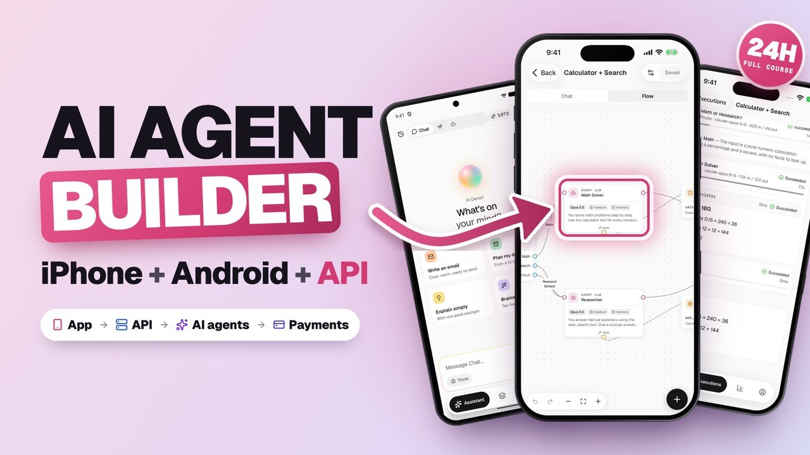
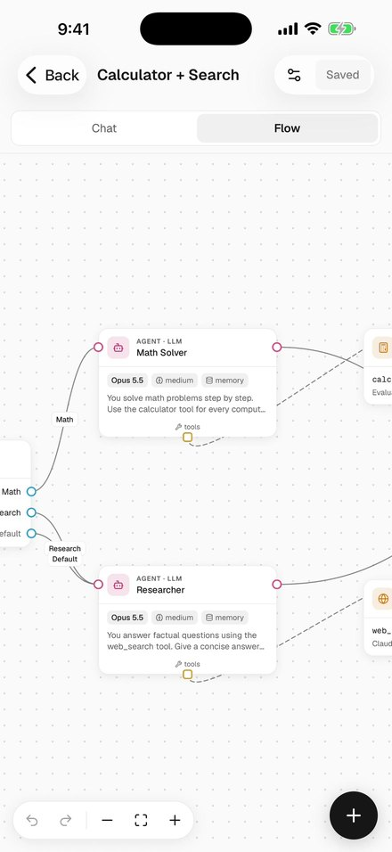
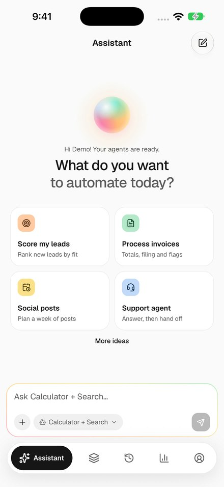
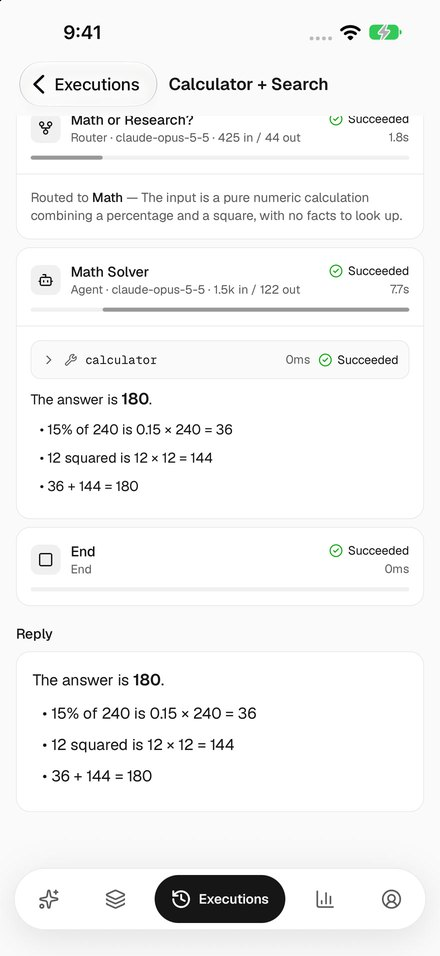
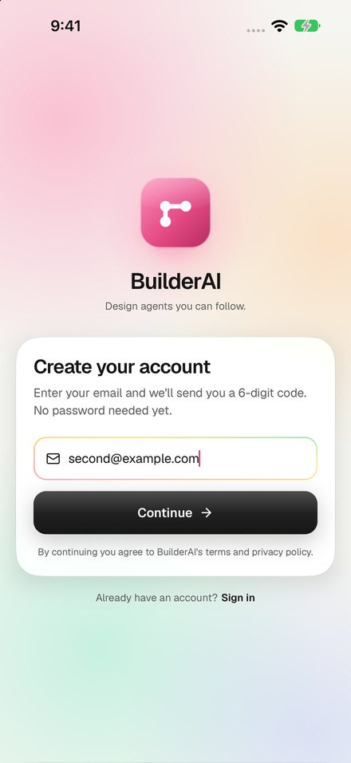
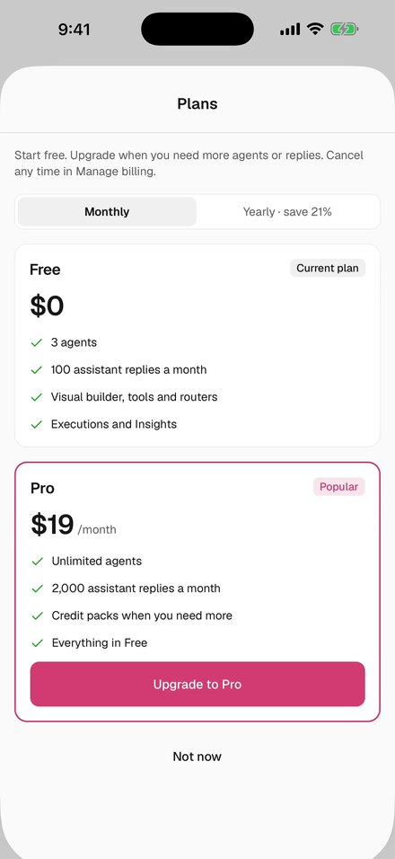
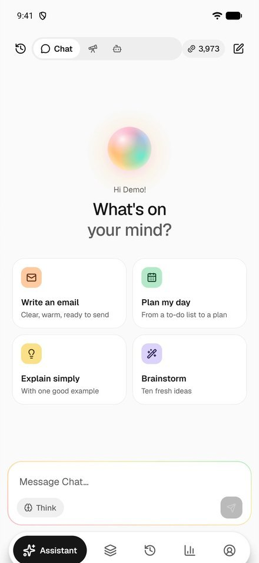

<div align="center">

<a href="https://youtu.be/itJnMlXe15k"></a>

# BuilderAI Mobile starter

### An AI agent builder for iPhone and Android, with its own server.

The starter repo for **BuilderAI Mobile + Server from Scratch**, a free full course on YouTube. You build a phone
app with Expo and React Native, and the NestJS API behind it: sign-in with email codes, a visual agent builder,
streaming chat with Claude, run history, Stripe plans and credits, then Docker and EAS builds for real phones.

**[▶ Watch the course](https://youtu.be/itJnMlXe15k)** ·
**[📝 Read the article](https://medium.com/@reactbd/next-js-developers-can-build-an-n8n-style-agent-builder-the-compiler-is-125-lines-4d0a51f21c00)** ·
**[🌐 reactbd.com](https://reactbd.com)**

</div>

---

## What you'll build

| | | |
| :---: | :---: | :---: |
|  |  |  |
| **The visual builder.** Agents, tools and routers on a canvas you drag and pinch, with undo and redo. | **The Assistant.** Chat, Deep Research and your own agents, with replies streaming in word by word. | **Every run, step by step.** Each step's model, tokens, timing and tool calls, read from the server. |
|  |  |  |
| **Sign-in four ways.** Email codes, passwords, Google and GitHub, with the session in the phone's keychain. | **Plans and credits.** Free and Pro with Stripe Checkout, credit packs and a signed web hook. | **iPhone and Android.** One Expo app, native views on both, built with EAS for real phones. |

Behind it: a NestJS API with Prisma 7 and PostgreSQL, Better Auth, a LangGraph runtime on Claude, safe tools,
run history and Insights, rate limits and security headers, tests, and a Docker image ready for a live host.

---

## What's in this repo

A read me and the app's images, the files that can't be typed:

| File | What it is |
| --- | --- |
| `assets/images/icon.png` | the app icon |
| `assets/images/splash-icon.png` | the splash screen picture |
| `assets/images/favicon.png` | the web favicon |
| `assets/images/android-icon-background.png` | the Android adaptive icon's background layer |
| `assets/images/android-icon-foreground.png` | its foreground layer |
| `assets/images/android-icon-monochrome.png` | its monochrome layer (themed icons) |

(`docs/images/` holds the pictures on this page.)

## How to use it

Clone it, and the clone is your project folder:

```bash
git clone https://github.com/noorjsdivs/builder-ai-mobile-starter.git
```

Or, in VS Code: Welcome → **Clone Git Repository**, paste the address, pick a folder and open it.

The course then makes both projects inside it, the official way:

- `server/` with `nest new server --strict --skip-git` (the folder already is a repository)
- `mobile/` with `npx create-expo-app@latest mobile`, which copies these images in with
  `cp ../assets/images/*.png assets/images/`

## What you need

- Node 22.13 or newer, Git and VS Code
- A Mac with Xcode for the iOS Simulator, or Android Studio with an emulator on Windows and Linux
- A free Neon database and a Claude API key (the API is paid per use)
- Later: Stripe in test mode, a Gmail app password, Google and GitHub OAuth apps, and optionally Tavily
- For going live: Docker, a free Expo account and, for the iPhone build, an Apple Developer membership

## Keep your keys out of git

The server's settings live in `server/.env`, which `.gitignore` keeps out of the repository. Commit `.env.example`
with empty values instead, and never put a key in the app: everything secret stays on the server.

---

<div align="center">

**[▶ Watch the full course on YouTube](https://youtu.be/itJnMlXe15k)** ·
**[📝 Medium](https://medium.com/@reactbd)** ·
**[🌐 reactbd.com](https://reactbd.com)**

</div>
